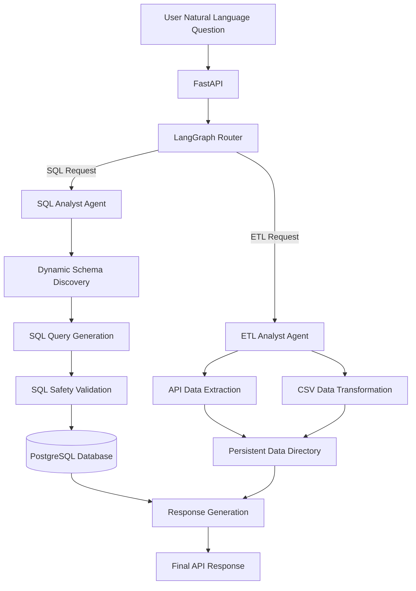
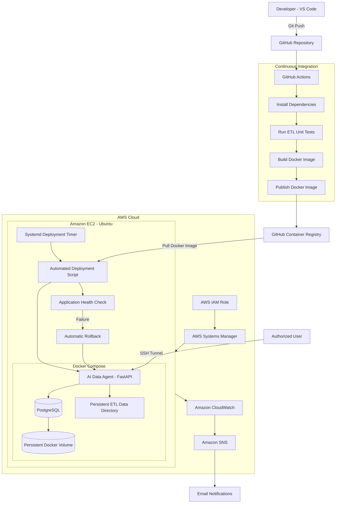
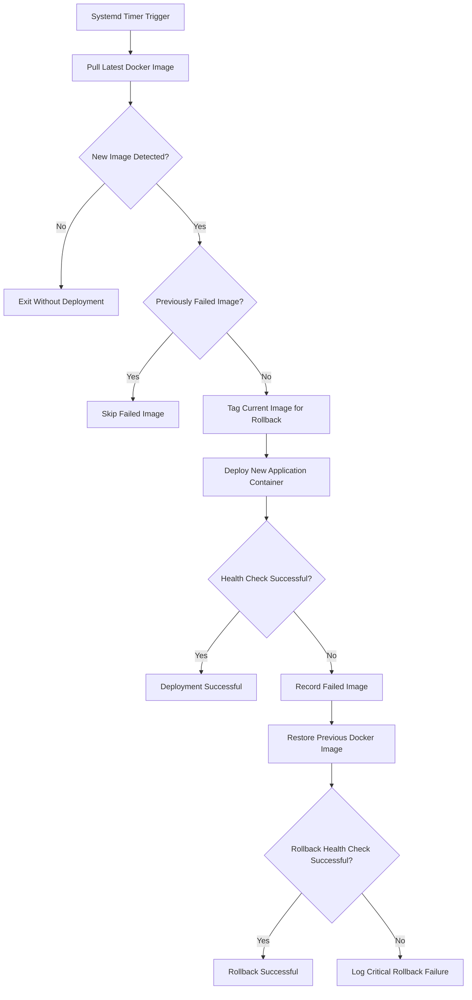
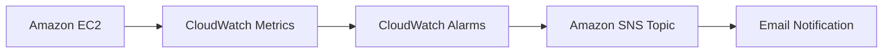

# AI-Powered Data Agent — AWS Deployment & CI/CD

An AI-powered multi-agent application that converts natural-language
questions into SQL queries and performs ETL operations using LangGraph,
FastAPI, and PostgreSQL.

The application is containerized using Docker and deployed on AWS EC2
with an automated CI/CD pipeline, health checks, rollback mechanisms,
infrastructure monitoring, and email notifications.

---

## 1. Project Overview

The AI-Powered Data Agent enables users to interact with structured
data using natural language without manually writing SQL queries.

The application uses an intelligent routing mechanism to direct
user requests to the appropriate specialized agent.

### Key Features

- Natural-language-to-SQL query generation.
- Dynamic PostgreSQL schema discovery.
- Multi-agent orchestration using LangGraph.
- SQL query safety validation.
- API data extraction and CSV transformation.
- REST API using FastAPI.
- Docker-based containerization.
- Automated CI/CD using GitHub Actions.
- Automated AWS EC2 deployment.
- Health-check-based rollback mechanism.
- Infrastructure monitoring and email alerts.

---

## 2. Technology Stack

| Category                | Technologies                           |
| ----------------------- | -------------------------------------- |
| Programming Language    | Python                                 |
| AI Framework            | LangGraph, LangChain                   |
| Artificial Intelligence | LLMs, Prompt Engineering, Tool Calling |
| Backend                 | FastAPI                                |
| Database                | PostgreSQL 17                          |
| Dependency Management   | uv                                     |
| Testing                 | Pytest                                 |
| Containerization        | Docker, Docker Compose                 |
| CI/CD                   | GitHub Actions                         |
| Container Registry      | GitHub Container Registry (GHCR)       |
| Cloud Platform          | AWS                                    |
| Compute                 | Amazon EC2                             |
| Storage                 | Amazon EBS, Docker Volumes             |
| Access Management       | AWS IAM                                |
| Server Management       | AWS Systems Manager                    |
| Monitoring              | Amazon CloudWatch                      |
| Notifications           | Amazon SNS                             |
| Deployment Automation   | Bash, Systemd                          |
| Operating System        | Ubuntu 24.04 LTS                       |
| Version Control         | Git, GitHub                            |

---

## 3. AI Application Architecture



### SQL Analyst Agent

- Retrieves database schema dynamically.
- Identifies relevant tables and columns.
- Generates SQL queries using an LLM.
- Performs SQL safety validation.
- Executes queries against PostgreSQL.
- Returns human-readable responses.

### ETL Analyst Agent

- Extracts data from supported external APIs.
- Saves extracted data into CSV files.
- Performs supported CSV filtering operations.
- Stores generated files in a persistent data directory.

---

## 4. AWS DevOps Architecture



---

## 5. Database Architecture

The PostgreSQL database contains five relational tables.

| Table    | Records |
| -------- | ------: |
| users    |  10,000 |
| rides    |  20,000 |
| vehicles |   3,000 |
| payments |  16,073 |
| ratings  |  12,000 |
| Total    |  61,073 |

The database uses relational tables and foreign-key relationships
to support SQL joins, aggregations, filtering, and analytical queries.

Database data is persisted using a Docker named volume.

---

## 6. Docker Containerization

The application uses Docker Compose to manage two services.

### AI Data Agent Container

- Runs the FastAPI application.
- Executes LangGraph agent workflows.
- Connects to PostgreSQL through the Docker network.
- Uses environment variables for configuration.
- Exposes the application on the EC2 loopback interface.
- Uses a persistent bind mount for ETL-generated files.

### PostgreSQL Container

- Uses the PostgreSQL 17 Docker image.
- Stores database records in a persistent named volume.
- Uses a database readiness health check.
- Communicates with the application through an internal Docker network.
- Does not expose the database port publicly.

### Resource Configuration

| Component                  | Configuration |
| -------------------------- | ------------- |
| EC2 Instance               | t3.micro      |
| CPU                        | 2 vCPUs       |
| Memory                     | 1 GiB         |
| EBS Storage                | 16 GiB gp3    |
| Application Memory Limit   | 400 MB        |
| PostgreSQL Memory Limit    | 200 MB        |
| Application Host Port      | 8002          |
| Application Container Port | 8000          |

---

## 7. CI/CD Pipeline

The CI/CD pipeline automates application testing, container image
creation, image publishing, and deployment.

### Continuous Integration

GitHub Actions automatically performs the following operations:

1. Checks out the GitHub repository.
2. Installs uv.
3. Configures Python 3.11.
4. Installs project dependencies.
5. Executes automated ETL unit tests.
6. Builds the Docker image.
7. Authenticates with GitHub Container Registry.
8. Publishes Docker images on pushes to the master branch.

Docker images are published with:

- latest tag
- Git commit SHA tag

Pull requests execute testing and image building without publishing
the Docker image.

### Continuous Deployment

A pull-based deployment mechanism runs on AWS EC2.

A Systemd timer checks GitHub Container Registry for application
updates approximately every five minutes after the previous
deployment check finishes.

When a new image is detected, the deployment script:

1. Downloads the latest Docker image.
2. Compares the running and downloaded image IDs.
3. Creates a rollback tag for the existing image.
4. Recreates the application container.
5. Executes application health checks.
6. Retains the new version if the health check succeeds.
7. Attempts to restore the previous image if deployment fails.

The PostgreSQL container is not recreated during normal
application updates.

---

## 8. Automated Rollback Mechanism



### Health Check Configuration

- Endpoint: `/health`
- Maximum attempts: 12
- Retry delay: 5 seconds
- Request timeout: 5 seconds

The deployment script records failed image IDs to prevent repeated
deployment attempts of the same failed image.

Deployment and rollback events are recorded in the Systemd journal.

---

## 9. AWS Infrastructure and Security

### Amazon EC2

- Ubuntu 24.04 LTS.
- Docker Engine and Docker Compose.
- Encrypted EBS root volume.
- CPU credit mode configured as Standard.
- Application and database hosted on a single EC2 instance.

### Security Groups

- SSH access restricted to an authorized IP address.
- No publicly exposed PostgreSQL port.
- No publicly exposed FastAPI application port.
- Application access through SSH port forwarding.

### AWS IAM

An IAM role is attached to the EC2 instance using the
AmazonSSMManagedInstanceCore managed policy.

This allows the instance to communicate with AWS Systems Manager
without manually configuring permanent AWS access keys.

### AWS Systems Manager

- Managed instance registration.
- Fleet Manager visibility.
- Remote command execution using Run Command.

### Secret Management

- Application credentials are stored in an environment file.
- Environment files are excluded from Git version control.
- Deployment configuration is stored in a root-owned directory.
- Environment file permissions are restricted to the owner.
- GitHub Actions uses GITHUB_TOKEN for registry publishing.

---

## 10. Monitoring and Notifications

Amazon CloudWatch monitors EC2 infrastructure metrics.

Amazon SNS delivers email notifications when configured alarms
enter the ALARM state.

| Alarm                    | Condition                                                   |
| ------------------------ | ----------------------------------------------------------- |
| High CPU Utilization     | CPU above 80% for three consecutive 5-minute periods        |
| EC2 Status Check Failure | StatusCheckFailed >= 1 for two consecutive 1-minute periods |

### Monitoring Workflow



SNS email notification delivery was verified by manually triggering
the configured CloudWatch alarm states.

---

## 11. API Endpoints

| Method | Endpoint | Description                       |
| ------ | -------- | --------------------------------- |
| GET    | /health  | Application health status         |
| GET    | /version | Application version               |
| POST   | /ask     | Process natural-language requests |
| GET    | /docs    | Swagger API documentation         |

### Example SQL Request

```json
{
  "question": "How many users are registered in the database?"
}
```

Generated SQL:

```sql
SELECT COUNT(*) AS user_count
FROM public.users;
```

Result: 10,000 registered users.

### Example Analytical Request

```json
{
  "question": "Find the top 5 users with the highest number of rides."
}
```

### Example ETL Request

```json
{
  "question": "Extract 10 Pokemon records from https://pokeapi.co/api/v2/pokemon/?limit=10 and save them as a CSV file at extract/aws_test_pokemon.csv inside the data directory."
}
```

---

## 12. Local Development Setup

### Prerequisites

- Git
- Python 3.11
- uv
- Docker
- Docker Compose
- Required LLM API credentials
- PostgreSQL database backup or seed data

### Clone the Repository

```bash
git clone https://github.com/rhishikesh-04/AI-Powered-Data-Agent.git
cd AI-Powered-Data-Agent
```

### Install Dependencies

```bash
uv sync --locked --dev
```

### Configure Environment Variables

Create a `.env` file in the project root.

Configure the required LLM API credentials and PostgreSQL
connection settings according to the application configuration.

Do not commit the `.env` file to GitHub.

### Run Unit Tests

```bash
uv run python -m pytest tests/test_etl_filter.py tests/test_etl_extract.py -v
```

### Start Docker Containers

```bash
docker compose up -d
```

### Check Container Status

```bash
docker compose ps
```

### Stop Containers

```bash
docker compose stop
```

---

## 13. AWS Deployment Setup

### Prerequisites

- AWS account.
- Ubuntu EC2 instance.
- Configured security group.
- SSH access to the instance.
- Required application environment variables.
- PostgreSQL database backup.
- Access to the published GHCR image.

### Clone the Repository on EC2

```bash
cd /home/ubuntu

git clone https://github.com/rhishikesh-04/AI-Powered-Data-Agent.git

cd AI-Powered-Data-Agent
```

### Install Docker

```bash
bash deploy/install-docker.sh
```

### Initial Application Deployment

Securely transfer the required `.env` file and database backup
to the EC2 instance.

Run the initial deployment script:

```bash
bash deploy/deploy-app.sh
```

Restore the database using the provided restore script:

```bash
bash deploy/restore-db.sh
```

The restore script is intended for initial database restoration.
Review its backup path requirements before execution.

### Configure Secured Deployment Directory

```bash
sudo install -d -o root -g root -m 750 /opt/ai-data-agent
```

Install the AWS Docker Compose configuration:

```bash
sudo install -o root -g root -m 640 \
deploy/docker-compose.aws.yml \
/opt/ai-data-agent/docker-compose.yml
```

Install the environment configuration:

```bash
sudo install -o root -g root -m 600 \
.env /opt/ai-data-agent/.env
```

Validate the configuration:

```bash
sudo docker compose \
-f /opt/ai-data-agent/docker-compose.yml \
config --quiet
```

Start or reconcile the secured deployment:

```bash
sudo docker compose \
-f /opt/ai-data-agent/docker-compose.yml \
up -d
```

The AWS Compose configuration uses the existing project name
to preserve the associated PostgreSQL named volume.

### Install Automated Deployment Script

```bash
sudo install -o root -g root -m 750 \
deploy/auto-deploy.sh \
/usr/local/sbin/ai-data-agent-auto-deploy
```

### Install Systemd Service

```bash
sudo install -o root -g root -m 644 \
deploy/ai-data-agent-deploy.service \
/etc/systemd/system/ai-data-agent-deploy.service
```

### Install Systemd Timer

```bash
sudo install -o root -g root -m 644 \
deploy/ai-data-agent-deploy.timer \
/etc/systemd/system/ai-data-agent-deploy.timer
```

### Enable Automated Deployment

After confirming that the application is running:

```bash
sudo systemctl daemon-reload

sudo systemctl enable --now ai-data-agent-deploy.timer
```

### Verify Timer Status

```bash
sudo systemctl status ai-data-agent-deploy.timer
```

### View Deployment Logs

```bash
sudo journalctl \
-u ai-data-agent-deploy.service \
-n 40 --no-pager
```

### Verify Application Health

```bash
curl http://127.0.0.1:8002/health
```

### Verify Application Version

```bash
curl http://127.0.0.1:8002/version
```

---

## 14. Secure Application Access

The application is accessible through SSH port forwarding
without publicly exposing the FastAPI port.

Run the following command from the local computer:

```bash
ssh -N -L 8003:127.0.0.1:8002 \
-i /path/to/key.pem ubuntu@EC2_PUBLIC_IP
```

Open Swagger UI in the local browser:

```text
http://localhost:8003/docs
```

Replace the private key path and EC2 public IP with the
appropriate values.

---

## 15. Deployment File Structure

```text
AI-Powered-Data-Agent/
|
|-- .github/
|   `-- workflows/
|       `-- ci.yml
|
|-- deploy/
|   |-- install-docker.sh
|   |-- deploy-app.sh
|   |-- restore-db.sh
|   |-- auto-deploy.sh
|   |-- ai-data-agent-deploy.service
|   |-- ai-data-agent-deploy.timer
|   `-- docker-compose.aws.yml
|
|-- tests/
|   |-- test_etl_filter.py
|   `-- test_etl_extract.py
|
|-- data/
|-- api.py
|-- Dockerfile
|-- docker-compose.yml
|-- pyproject.toml
|-- uv.lock
|-- .gitattributes
`-- README.md
```

---

## 16. Testing and Validation

The following components were tested during project implementation:

- Automated ETL unit tests.
- Docker image building and publishing.
- PostgreSQL database restoration.
- Natural-language SQL query execution.
- Multi-table analytical SQL queries.
- API data extraction.
- CSV filtering and transformation.
- ETL file persistence on the EC2 host.
- Application health and version endpoints.
- Automatic image detection and deployment.
- Health check retry mechanism.
- AWS Systems Manager connectivity.
- CloudWatch and SNS email notification delivery.

### Observed CI/CD Results

| Metric                                         | Observed Result    |
| ---------------------------------------------- | ------------------ |
| GitHub Actions workflow duration               | 1 minute 4 seconds |
| Deployment duration after image detection      | 18 seconds         |
| Manual deployment commands for observed update | None               |
| Application health check                       | Passed             |

These results represent a successful observed deployment run,
not guaranteed performance benchmarks.

---

## 17. AWS Cost Management

The project was designed as a small-scale deployment using
AWS Free Plan resources and promotional credits.

Cost-management measures include:

- Small EC2 instance configuration.
- Standard CPU credit mode.
- Limited EBS storage.
- AWS budget email notifications.
- Single-instance architecture.
- Container resource limits.
- No dedicated load balancer.
- No managed Kubernetes cluster.
- No separate managed database instance.

AWS budget alerts are notifications, not hard spending limits.
Resource usage and remaining credits should be monitored regularly.

---

## 18. Current Limitations

- Single EC2 instance without high availability.
- Brief application downtime during container replacement.
- Limited compute and memory resources.
- PostgreSQL and the application share the same EC2 instance.
- Deployment checks use a polling-based Systemd timer.
- Deployment uses the mutable latest image tag.
- Application health checks do not validate every AI workflow.
- Automated rollback depends on the previous image remaining available.
- Rollback does not cover every possible infrastructure failure.
- CloudWatch monitoring currently focuses on EC2 infrastructure metrics.
- GitHub Actions dependencies require future runtime compatibility updates.
- The application is not exposed through a public HTTPS endpoint.

---

## 19. Future Enhancements

- Amazon Elastic Container Registry (ECR).
- Kubernetes-based container orchestration.
- Amazon Elastic Kubernetes Service (EKS).
- Infrastructure as Code using Terraform.
- AWS Secrets Manager integration.
- Application Load Balancer and HTTPS.
- Blue-green or rolling deployments.
- Centralized application logging.
- Application-level metrics and monitoring.
- Automated database backup and recovery.
- High-availability infrastructure.

These enhancements are planned and are not part of the
current implementation.

---

## 20. Learning Outcomes

This project demonstrates practical knowledge of:

- AI agent development and orchestration.
- REST API development.
- PostgreSQL database integration.
- Docker containerization.
- Automated testing.
- CI/CD pipeline implementation.
- AWS EC2 infrastructure management.
- Linux server administration.
- Bash scripting and Systemd automation.
- Health-check-based deployment and rollback.
- AWS IAM and Systems Manager.
- Infrastructure monitoring and alerting.
- Cloud security and cost management.

---

## Author

**Rhishikesh Kulthe**

GitHub: https://github.com/rhishikesh-04

---

Built as a hands-on AI Engineering, Cloud Computing,
and DevOps learning project.
